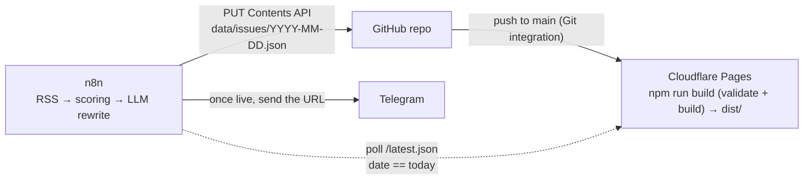

# News Daily: a daily newspaper template for n8n

A static, newspaper-style daily site. **n8n** commits one JSON file per day, and **Cloudflare Pages** (Git integration) builds and deploys it. Fork it, edit `site.config.json`, and you have your own paper.

- No framework, no dependencies. One Node 20 build script, plain HTML and CSS, a few lines of JS for dark mode.
- No external trackers. Fonts (Noto Serif / Noto Sans) load from Google Fonts with system-font fallbacks.
- Mobile-first, dark mode (follows the system, manual toggle), basic SEO and Open Graph tags.

> The three issues in `data/issues/` are **fictional sample data** (marked "[Sample]"). Delete them before going live.

## Architecture



| Part | Responsibility |
| --- | --- |
| n8n (not in this repo) | Fetch RSS, score importance, rewrite with an LLM, commit the JSON, poll for the deploy, notify Telegram |
| This repo | Validate, render, archive, expose the `/latest.json` checkpoint. Deployment is handled by Cloudflare's Git integration |

## Layout

```
site.config.json          paper name, tagline, URL, timezone, sections (order / name / color), per-section limit, primary color, footer
data/issues/*.json        one file per day; the file name is the issue date
schema/issue.schema.json  data format
scripts/validate.mjs      runs before every build (bad data → exit 1 → the Cloudflare build fails, the live site stays on the previous version)
scripts/build.mjs         the single build script, zero dependencies, writes dist/
src/style.css, theme.js   styles and the dark-mode toggle
```

Output: `/` (latest issue), `/YYYY-MM-DD/`, `/archive/`, `/feed.xml`, `/latest.json`, `/404.html`, `sitemap.xml`, `robots.txt`.
Every page has `<meta name="issue-date">`: issue pages carry their own date, other pages carry the latest issue's date.

## Local use

Node 20+. There are no dependencies, so no `npm install` is needed.

```bash
npm run validate   # validate site.config.json and data/issues/*.json
npm run build      # validate, then write dist/
npm run dev        # build, then serve dist/ at http://localhost:3000 with npx serve
```

> Links are root-relative (`/archive/`), so preview with `npm run dev` rather than opening `dist/index.html` directly.

## Setup

1. **Fork** this repo.
2. **Create a Cloudflare Pages project**: Workers & Pages → Create → Pages → **Connect to Git**, and pick your fork. Settings:
   - Production branch: `main`
   - Build command: `npm run build`
   - Build output directory: `dist`
   - Environment variable (recommended): `NODE_VERSION` = `20`
3. **Custom domain** (optional): project → Custom domains.
4. No GitHub Secrets, Variables or Cloudflare API token are needed.
5. **Create a fine-grained PAT for n8n**: Settings → Developer settings → Fine-grained tokens. Limit repository access to this repo and grant only `Contents: Read and write`.
6. **Edit `site.config.json`**: name, tagline, `url` (your `*.pages.dev` or custom domain), sections, primary color, footer.
7. Delete the sample issues (keep a `.gitkeep` in `data/issues/`) and push to `main`. With no issues the site shows a "Coming soon" page.

> Every push to `main` triggers a Cloudflare build. If `validate` fails, that deploy fails and the previous version stays live; the error shows up under Deployments in Cloudflare.

## Committing from n8n

`PUT /repos/{owner}/{repo}/contents/data/issues/{date}.json` with a base64 `content`. **When you re-run the same day you must send the existing file's `sha`**, otherwise GitHub answers 422.

```bash
OWNER=you REPO=daily-paper-template DATE=2026-11-10
API=https://api.github.com/repos/$OWNER/$REPO/contents/data/issues/$DATE.json

# 1) get the sha of the existing file (empty if it does not exist)
SHA=$(curl -s -H "Authorization: Bearer $GH_PAT" -H "Accept: application/vnd.github+json" "$API" | jq -r '.sha // empty')

# 2) create or update
curl -X PUT "$API" \
  -H "Authorization: Bearer $GH_PAT" -H "Accept: application/vnd.github+json" \
  -d "$(jq -n --arg m "issue $DATE" --arg c "$(base64 -w0 issue.json)" --arg s "$SHA" \
        '{message:$m, content:$c, branch:"main"} + (if $s != "" then {sha:$s} else {} end)')"
```

In n8n, use an HTTP Request node: GET first (treat 404 as "no file yet", e.g. with `Never Error`), then PUT.

## Confirming the deploy

Cloudflare finishes building about a minute after the push. Poll `/latest.json` (add a random query parameter; the site also sends `Cache-Control: no-store` for it) and notify Telegram only once `date` equals today:

```
GET https://<your-site>/latest.json?t={{ $now.toMillis() }}
→ {"date":"2026-11-10","edition":123,"url":"https://…/2026-11-10/"}
condition: {{ $json.date === $now.setZone('Asia/Taipei').toFormat('yyyy-MM-dd') }}
suggestion: every 30 seconds, at most 20 tries, then alert on timeout.
```

With no issues yet, `latest.json` is `{"date":null,"edition":0,...}`, which never matches a date.

## Data format

See `schema/issue.schema.json`. Required top-level fields: `date`, `generated_at`, `edition`, `headline`, `brief`, `sections`, `stats`. Each item requires `title`, `summary`, `why`, `importance` (1–5), `source_name` and `source_url`. Optional: `original_title`, `original_lang` (`en` | `zh`), `published_at`, `tags`, `image` (https URL), `image_alt`.

```json
{
  "date": "2026-11-10",
  "generated_at": "2026-11-10T07:00:00+08:00",
  "edition": 123,
  "headline": { "title": "…", "summary": "…", "why": "…", "importance": 5,
                "source_name": "…", "source_url": "https://…" },
  "brief": "Three sentences. One. Two. Three.",
  "sections": [ { "id": "ai", "items": [ { "...": "same fields as headline" } ] } ],
  "stats": { "feeds": 39, "fetched": 812, "kept": 36, "jev_cost_usd": 0.0012, "llm_cost_usd": 0.03 }
}
```

Section `id`s should match `site.config.json`; an unknown id is appended at the end in the primary color (validation prints a warning). Items are sorted by `importance` (5 = large type) and capped at `max_items_per_section`. The `brief` is shown as a numbered list when it has 2–5 sentences.

## License

MIT
